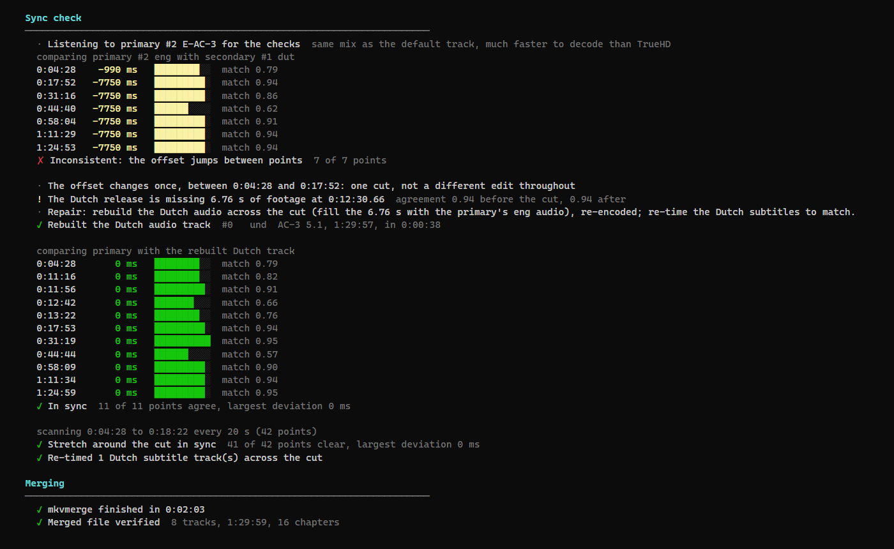
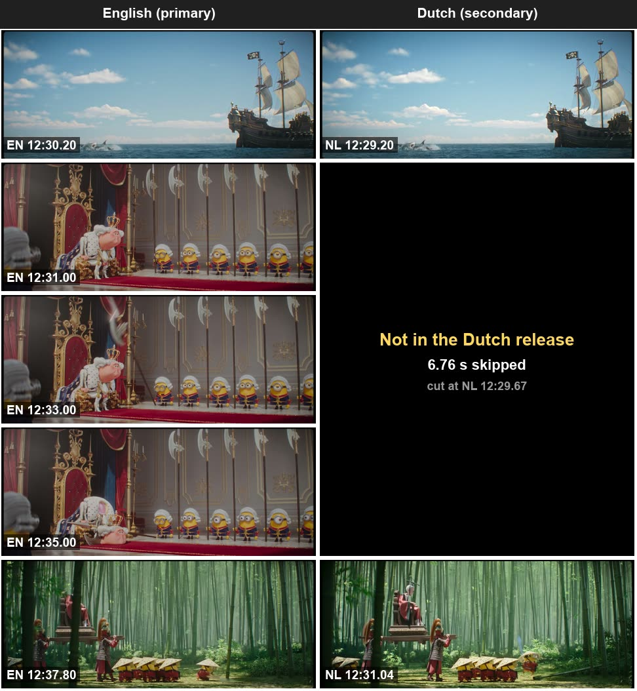

# Merge-MkvAudio

Add a Dutch (or any other language) audio track to a movie you already have, taken from a second release of the same movie.

A typical case: you have a good English 2160p release, and a 1080p release that also has Dutch audio and Dutch subtitles. Merge-MkvAudio puts the Dutch audio, and where needed the Dutch subtitles and chapters, into the 2160p file, so you end up with one file that has the best video and both languages.

## What it does

From the **secondary** file it adds to the **primary** file:

| What | When |
|---|---|
| The best Dutch audio track (most channels, then lossless, then bitrate) | Always. Without Dutch audio in the secondary, nothing happens. |
| Dutch SRT subtitles (non-forced) | Only when the primary has no non-forced Dutch SRT. Dutch image subtitles (PGS, VobSub) in the primary do not count, so an SRT is still added. |
| A sidecar Dutch SRT file (`<movie>.nl.srt`, also `.nld`, `.dut`, `.dutch`, with optional `.sdh`) | Only when neither file has a Dutch SRT embedded. One next to the primary is preferred over one next to the secondary. Its character set (UTF-8 or Windows-1252) is detected so accented letters survive. The sidecar file itself is left where it is. |
| Chapters | Only when the primary has none. |

What it never does:

- It never takes video, attachments, tags, image subtitles or forced subtitles from the secondary.
- It never changes the primary's own tracks or flags. Its original audio stays the default; the added tracks are neither default nor forced.
- It never changes the secondary file.

## Requirements

- Windows with PowerShell 7 or later.
- [MKVToolNix](https://mkvtoolnix.download/) (`mkvmerge`) and [ffmpeg](https://ffmpeg.org/) on `PATH`.
- Free space on the primary's drive of about the primary's size plus the added tracks. The script checks this first.

## Use it

### Interactive (easiest)

```powershell
.\Merge-MkvAudio.ps1
```

It asks for the two files. Paste a path, with or without quotes, or drag the file into the terminal window. It then shows both files, the plan and the sync check, and asks before it writes anything. At the end it offers to do another pair. Press Enter on an empty line to quit.

### With paths

```powershell
# Look first: shows everything, writes nothing
.\Merge-MkvAudio.ps1 -Primary 'D:\Movies\Film (2024)\Film (2024).mkv' -Secondary 'D:\Downloads\Film.2024.NL\Film.2024.mkv' -WhatIf

# Merge
.\Merge-MkvAudio.ps1 -Primary 'D:\Movies\Film (2024)\Film (2024).mkv' -Secondary 'D:\Downloads\Film.2024.NL\Film.2024.mkv'
```

### What happens to your files

1. The merge is written next to the primary as `<name>.merging.mkv.partial`. Media servers ignore that extension.
2. The result is checked: track count, the added tracks, duration, chapters, and that the primary's audio is still the only default.
3. Only if that passes, the primary is renamed to `<name>.mkv.bak`, the merged file takes its name, and the `.bak` is deleted.
4. With `-KeepBackup` the `.bak` is kept instead, for you to delete once you have checked the result.

If anything fails or you press Ctrl+C, the `.partial` file is removed and the primary is left as it was.

## The sync check

Two releases of the same film do not always line up. One may have an extra studio logo, a different cut, or run at a different speed. Before merging, the script checks this by listening rather than by trusting timestamps:

- At seven points across the film it takes 30 seconds of the primary's audio and a minute of the secondary's Dutch audio around the same moment.
- It reduces both to a loudness curve (10 ms resolution) and slides one along the other to find where they match best. The dialogue differs between languages, but music, effects and scene changes are shared, so a correct pairing still gives a clear peak.
- If the Dutch track is too different to compare, it retries with the secondary's own English track, which shares the Dutch track's timeline.

The result is one of:

| Verdict | Meaning | What happens |
|---|---|---|
| In sync | Every point is within 40 ms of zero. | Merges. |
| Fixed offset | Every point agrees on the same offset, for example 480 ms late. | The added tracks are shifted by that amount and the check runs again. If that re-check is in sync, it merges with the shift. |
| Drifting | The offset grows steadily, usually 25 fps (PAL) against 23.976 fps. | Stops. Fixing this needs re-timing the audio, which this script does not do. |
| One cut | The offset changes once and stays the same before and after: one release has a few seconds of footage the other lacks, such as a localized title card. | The cut is located to 10 ms and can be repaired (see below). Interactive mode asks; with paths, pass `-RepairCut`. |
| Inconsistent | The offset jumps around: a different cut throughout, or several scenes added or removed. | Stops. |
| Inconclusive | Too few points gave a clear match. | Stops (interactive mode asks). |

`-Force` merges anyway. The check takes about ten seconds.

### Repairing a single cut

Dubbed releases sometimes lack a few seconds the original has (or the other way round). A single offset cannot fix that: the start would be right and the rest wrong, or the other way round. When the sync check sees exactly one jump, the script:

1. Finds the cut to 10 ms, by comparing both soundtracks moment by moment under the offset before the jump and the offset after it. It reports where the cut is and how well each side agrees (1.00 is perfect). Below 0.50 on either side it does not repair.
2. Rebuilds the added audio track with ffmpeg: the added language up to the cut, then the primary's own audio for the missing seconds (so the shot is not silent), then the rest. If the added release has extra footage instead, those seconds are cut out. The track is re-encoded: AC-3 as AC-3 at 640 kb/s, anything else as E-AC-3 at 640 kb/s or the original bitrate if higher. Re-encoding a lossy track costs a little quality; the high bitrate keeps that small.
3. Re-times the added subtitles across the same cut (cues inside removed footage are dropped).
4. Runs the sync check again on the rebuilt track, at the usual seven points plus four close around the cut, and then scans the whole stretch that held the jump every 20 seconds. Two cuts close together look like one bigger jump at the seven points; the scan shows any part that is still out of sync. It only merges if both say in sync.

It repairs gaps up to 30 seconds (`-MaxRepairGapS`). A few seconds of original-language sound in a dubbed track go unnoticed; a missing scene of several minutes would not.

The secondary's chapters are not used in this case, since they follow the other cut. The rebuilt files are temporary and are deleted when the script ends.

#### Example: a Dutch release missing one shot

The Dutch release of an animated film ran 8 seconds short. The first sync point was 1 second off and every later point was 7.75 seconds off, so the script stopped calling it a plain offset, found the cut at 12:30.66, rebuilt the Dutch track and checked it again before merging:



The frames show what was missing. The English release has a 6.76-second shot between the pirate ship and the bamboo forest; the Dutch release cuts straight from one to the other, at the moment the script measured. In the merged file the Dutch track plays the English sound for that one shot.



## Options

| Parameter | Default | What it does |
|---|---|---|
| `-Primary` | | The file to merge into. Omit it (and `-Secondary`) for interactive mode. |
| `-Secondary` | | The file to take the language from. |
| `-Language` | `nl` | The language to merge, such as `de` or `fr`. |
| `-AudioTrackId` | | Use this audio track ID of the secondary instead of choosing by language. |
| `-SyncOffsetMs` | `0` | Shift the added tracks by this many ms (negative is earlier). Rarely needed, since the sync check finds fixed offsets itself. |
| `-SkipSyncCheck` | | Do not run the sync check. |
| `-Force` | | Merge even when the checks do not pass. |
| `-KeepBackup` | | Keep the original as `<name>.mkv.bak` instead of deleting it after a verified merge. |
| `-RepairCut` | | Repair a single cut found by the sync check without asking (see above). |
| `-MaxRepairGapS` | `30` | The longest gap, in seconds, a cut repair may fill or remove. |
| `-OutputPath` | | Write the merged file here and leave the primary untouched, for example while it is still seeding. The file must not exist yet. |
| `-WhatIf` | | Show everything, write nothing. |
| `-Verbose` | | Also print the full `mkvmerge` command. |

## Troubleshooting

**"The secondary file has no Dutch audio track."** The track may be tagged with the wrong language. Look at the track list printed above the plan and pass `-AudioTrackId <id>`.

**It asks "Is ... Dutch?"** A track has no language tag (`und`), so the script cannot tell. Answer y or n; it never guesses.

**"A backup already exists"** A previous merge with `-KeepBackup` left `<name>.mkv.bak`. Check it, then delete or move it.

**"Frame rates differ"** or **"Drifting"** The two releases run at different speeds. Find a secondary release at the same frame rate.

**"Inconclusive"** Check a few scenes by hand. If the audio is right, run again with `-Force`.

**"The cut could not be located reliably"** The two soundtracks are too different around the cut to place it safely. Try another release of either language.

**"Pass -RepairCut to repair it"** The sync check found a single cut, but you ran the script with paths. Add `-RepairCut`, or run it interactively.

## Development

Lint and tests run with PSScriptAnalyzer and Pester 5, locally through pre-commit and in CI:

```powershell
pre-commit install; pre-commit install --hook-type pre-push
Invoke-ScriptAnalyzer -Path . -Recurse -Settings .\PSScriptAnalyzerSettings.psd1
Invoke-Pester .\Tests
```

The decision logic (track selection, sync verdicts, mkvmerge arguments, output checks) is in `Modules\MkvAudioMerge.psm1` and is tested without media files.

## License

MIT
